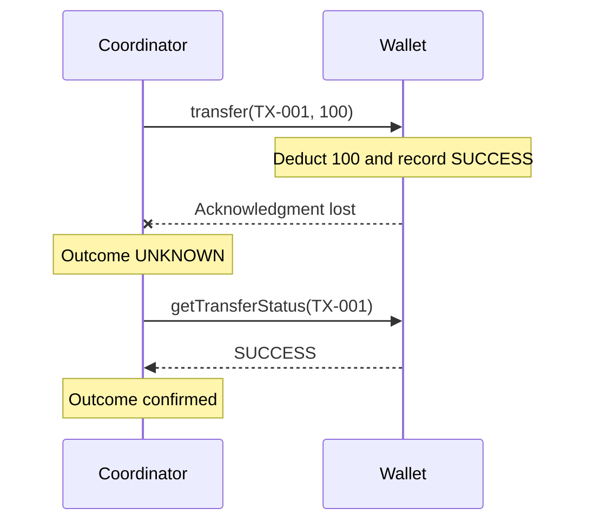

# Wallet Systems Lab

**Experiment 01 — Lost Acknowledgment**

An independent, fictional backend engineering project exploring transaction correctness, idempotency, failure recovery, and distributed-system reasoning.

Built using **Java 21**, without external frameworks or payment integrations.

## 1. Project Overview

What happens when a wallet successfully processes a transfer, but the coordinator never receives confirmation?

The coordinator cannot determine whether the transfer succeeded or failed. Retrying incorrectly could cause the same logical transfer to be applied twice.

This project explores how transaction identifiers, idempotency, and status lookups help prevent duplicate deductions while preserving correctness under uncertainty.

## 2. Safety Invariant

**One logical transfer request must not cause more than one applied transfer.**

The wallet enforces this for sequential requests by recording each transaction ID, amount, and result.

- New transaction ID: validate and process the transfer, then record its outcome.
- Existing ID with the same amount: return the recorded result without changing the balance.
- Existing ID with a different amount: return `CONFLICT` without changing the balance or original record.

A retry of the same logical transfer must preserve its original transaction ID.

## 3. Architecture

The experiment models two conceptual participants:

- **Coordinator:** Initiates transfers, tracks known outcomes, and attempts recovery after missing responses.
- **Wallet:** Processes transfers, stores transaction results, maintains the balance, and supports status lookups.

The coordinator's behavior is simulated in `Main.java`; it is not a separate network service.



Communication failures are simulated deterministically through controlled execution order and ignored responses.

## 4. Transaction Outcomes

| State | Meaning |
|---|---|
| `SUCCESS` | The wallet applied the transfer. |
| `FAILED` | The wallet rejected the transfer and recorded the failure. |
| `CONFLICT` | An existing transaction ID was reused with a different amount. |
| `NOT_FOUND` | The wallet has no record of that ID at lookup time. |
| `UNKNOWN` | The coordinator has not established the final outcome. |

`UNKNOWN` is a coordinator-side state, not a wallet response.

A `NOT_FOUND` response does not prove failure because the original transfer request may still be delayed.

## 5. Implemented Features

- In-memory wallet with an initial balance of 500 credits.
- Positive-amount validation and insufficient-funds handling.
- Transaction recording using IDs, amounts, and outcomes.
- Idempotent sequential retries.
- Conflict detection for reused IDs with different amounts.
- Read-only transaction status lookup.
- Four deterministic failure and recovery demonstrations.
- Eight automated assertion-based test methods.
- Single-command compilation, testing, and demonstration.

## 6. Project Structure

```text
wallet-systems-lab/
├── README.md
├── PROGRESS.md
├── run.sh
├── docs/
│   └── design.md
└── src/
    └── main/
        └── java/
            └── lab/
                └── wallet/
                    ├── Wallet.java
                    ├── WalletTest.java
                    └── Main.java
```

| File | Responsibility |
|---|---|
| `Wallet.java` | Transfer processing, balance management, transaction recording, and idempotency. |
| `WalletTest.java` | Automated correctness and failure-case tests. |
| `Main.java` | Deterministic failure and recovery demonstrations. |
| `run.sh` | Clean compilation, test execution, and demonstration. |
| `docs/design.md` | Architecture, design decisions, failure analysis, and limitations. |
| `PROGRESS.md` | Experiment progress and learning checkpoints. |

## 7. Requirements

- Java 21 or newer, including the JDK.
- Bash.

No database, Maven, Docker, external service, or additional dependency is required.

## 8. Quick Start

From the repository root, run:

```bash
bash run.sh
```

This single command:

1. Removes previously compiled files.
2. Compiles the Java source.
3. Executes all eight automated tests with assertions enabled.
4. Runs all four deterministic demonstrations.

The script stops if compilation or test execution fails.

No source-code modifications are required to switch between scenarios.

### Verified Output

The following output was observed on November 24, 2026:

```text
All Test passed

=== Lost Acknowledgment ===
Coordinator status: UNKNOWN
Recovered status: SUCCESS
Final balance: 400

=== Unsafe Retry ===
SUCCESS
SUCCESS
Final balance: 300

=== Safe Retry ===
SUCCESS
SUCCESS
Final balance: 400

=== Delayed Request ===
NOT_FOUND
SUCCESS
Final balance: 400
```

## 9. Experiments

Each demonstration starts with an independent wallet containing 500 credits.

### Experiment A — Lost Acknowledgment

The wallet processes a 100-credit transfer, but the coordinator does not receive the acknowledgment.

The coordinator queries the original transaction ID and recovers the confirmed outcome.

**Result:** The coordinator transitions from `UNKNOWN` to `SUCCESS`. The final balance is 400 credits.

### Experiment B — Unsafe Retry

The coordinator submits `TX-001` and then uses `TX-002` to retry the same logical transfer.

The wallet treats the requests as separate transactions.

**Result:** Both deductions occur. The final balance is 300 credits, violating the logical-transfer safety invariant.

### Experiment C — Safe Retry

The coordinator submits `TX-001` twice with the same amount of 100 credits.

The wallet recognizes the repeated transaction ID and returns the recorded result.

**Result:** Only one deduction occurs. The final balance is 400 credits.

### Experiment D — Delayed Request

The coordinator queries `TX-001` before the wallet processes it.

The first lookup returns `NOT_FOUND`. After the wallet processes the transfer, a second lookup returns `SUCCESS`.

**Result:** The final balance is 400 credits. The experiment demonstrates why `NOT_FOUND` must not be interpreted as definitive failure.

### Results Summary

| Experiment | Observed outcome | Final balance |
|---|---|---:|
| Lost acknowledgment | Outcome recovered | 400 |
| Unsafe retry | Duplicate deduction reproduced | 300 |
| Safe retry | Duplicate deduction prevented | 400 |
| Delayed request | `NOT_FOUND` followed by `SUCCESS` | 400 |

## 10. Automated Tests

The project contains eight automated test methods implemented using Java assertions.

| Test | Behavior verified |
|---|---|
| `testTransfer()` | Identical successful retries do not deduct twice. |
| `testConflictingAmount()` | Reusing an ID with a different amount returns `CONFLICT`. |
| `testRepeatedFailure()` | Repeated failed requests return the recorded failure. |
| `testConflictAfterFailure()` | Changing the amount of a previously failed request returns `CONFLICT`. |
| `testTransferStatus()` | Existing and missing transaction IDs return the expected lookup results. |
| `testInvalidAmount()` | Negative transfer amounts are rejected without changing the balance. |
| `testUnsafeRetry()` | Different transaction IDs can cause duplicate deductions. |
| `testSafeRetry()` | Retrying with the same transaction ID prevents duplicate deductions. |

All eight test methods passed during the reported clean execution of `run.sh`.

The unsafe-retry test intentionally reproduces a safety violation. A passing test confirms that the expected failure behavior was reproduced, not that the retry strategy is safe.

### Running Tests Separately

```bash
rm -rf out
javac -d out src/main/java/lab/wallet/*.java
java -ea -cp out lab.wallet.WalletTest
```

The `-ea` flag enables Java assertions. Without this flag, assertion-based checks are disabled.

## 11. Safety and Liveness

### Safety

Under the current sequential implementation, retrying a transfer using the same transaction ID and amount does not cause another deduction.

This guarantee depends on preserving the original transaction ID and retaining its recorded outcome.

### Liveness

The coordinator is not guaranteed to learn the final outcome.

If responses are continuously lost, the coordinator may remain `UNKNOWN` indefinitely.

Idempotency prevents duplicate execution under the experiment's assumptions. It does not guarantee successful communication or eventual recovery.

## 12. Engineering Decisions

| Decision | Rationale | Tradeoff |
|---|---|---|
| Plain Java 21 | Focus on correctness without framework overhead. | No application framework or service infrastructure. |
| In-memory storage | Simple, deterministic experiments. | No durability across process restarts. |
| Transaction ID and amount matching | Detect repeated and conflicting requests. | More complex payloads require additional identity checks. |
| Sequential execution | Isolate transaction and failure reasoning. | No concurrency guarantees. |
| Deterministic simulation | Reproduce failure scenarios consistently. | Does not establish real network behavior. |
| Java assertions | Lightweight automated verification. | Assertions must be explicitly enabled. |

## 13. Assumptions and Limitations

The current implementation assumes:

- One caller and sequential transfer processing.
- Positive integer transfer amounts.
- Transaction records remain available throughout the simulation.
- Retries of the same logical operation preserve the original transaction ID.

The project does not implement:

- Concurrent transaction processing.
- Durable transaction storage.
- Atomic crash recovery.
- Real network communication.
- Distributed deployment.
- Reconciliation jobs.
- Performance benchmarking.

Balance deduction and transaction recording are separate operations. Their consistency during concurrent execution or process crashes has not been established.

The experiment demonstrates correctness under its stated assumptions, not production-grade payment guarantees.

## 14. Key Engineering Lessons

- A missing acknowledgment creates uncertainty, not necessarily failure.
- The actual state of a system and another participant's knowledge of that state are different.
- Retrying a request is not automatically safe.
- Idempotency depends on preserving logical request identity.
- A missing transaction record does not necessarily establish a failed transaction.
- Safety and liveness are separate properties.
- Correctness claims require explicit assumptions and reproducible evidence.

## 15. Further Engineering Experiments

The following topics are outside the frozen v1 scope and are candidates for future experiments:

- Concurrent requests and race conditions.
- Durable transaction records.
- Atomic balance updates and transaction recording.
- Process crashes and recovery.
- Reconciliation of uncertain outcomes.
- Performance measurement and optimization.

These are potential extensions, not capabilities of the current implementation.

## 16. Design Documentation

For a detailed explanation of the architecture, safety invariant, recovery strategy, failure-case test matrix, engineering tradeoffs, and limitations, see:

[Design Notes — Experiment 01](docs/design.md)

## Disclaimer

Wallet Systems Lab is an independent, fictional engineering learning project.

It is not affiliated with any real company, financial institution, payment provider, or production payment system.

All transaction identifiers, balances, and failure scenarios are fictional. The implementation is intended for educational purposes and is not suitable for processing real financial transactions.