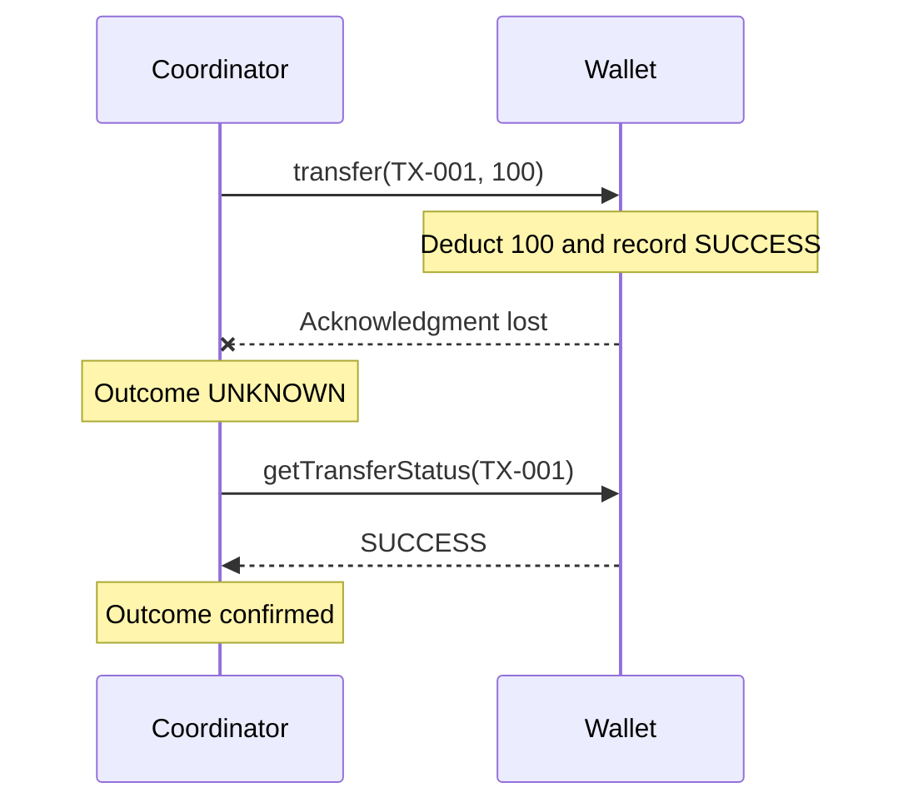

# Design Notes — Experiment 01: Lost Acknowledgment

## 1. Problem

A coordinator sends a transfer request to a wallet. The wallet successfully processes the transfer, but the acknowledgment is lost before reaching the coordinator.

The wallet knows the transfer succeeded, but the coordinator does not know the outcome.

If the coordinator retries the logical transfer using a new transaction ID, the wallet may process it again, resulting in a duplicate deduction.

The challenge is to recover the outcome without applying the same logical transfer more than once.

## 2. Safety Invariant

**One logical transfer request must not cause more than one applied transfer.**

The wallet enforces this for sequential requests by recording each transaction ID, its amount, and its result.

When a request arrives:

- If the ID is new, the wallet validates and processes the transfer.
- If the ID exists and the amount matches, the wallet returns the recorded result without changing the balance.
- If the ID exists but the amount differs, the wallet returns `CONFLICT` without changing the balance.

The coordinator must preserve the original transaction ID when retrying the same logical operation.

## 3. Architecture and Recovery Flow

The experiment models two conceptual participants:

- **Coordinator:** Initiates transfers, tracks known outcomes, and attempts recovery when responses are lost.
- **Wallet:** Processes transfers, maintains the balance, records transaction outcomes, and provides status lookups.

The coordinator is simulated within `Main.java`. It is not a separate network service.



Network delays and lost acknowledgments are simulated deterministically through controlled execution order and ignored responses.

## 4. Transaction States

| State | Meaning |
|---|---|
| `SUCCESS` | The wallet successfully applied the transfer. |
| `FAILED` | The wallet rejected the transfer and recorded the failure. |
| `CONFLICT` | An existing transaction ID was reused with a different amount. |
| `NOT_FOUND` | The wallet has no record of the transaction at lookup time. |
| `UNKNOWN` | The coordinator cannot determine the final outcome. |

`UNKNOWN` is a coordinator-side state, not a wallet transfer result.

`NOT_FOUND` does not necessarily mean failure. The original request may still be delayed and could arrive later.

`CONFLICT` describes a rejected attempt to reuse an existing transaction ID with a different amount. It does not overwrite the original recorded outcome.

## 5. Recovery Strategy

When an acknowledgment is lost, the coordinator must not assume the transfer failed.

It can query the wallet using the original transaction ID.

- If the lookup returns `SUCCESS` or `FAILED`, the coordinator can use that recorded outcome.
- If it returns `NOT_FOUND`, the coordinator retains `UNKNOWN` because the original request may still arrive.
- If the lookup response is lost, the coordinator also retains `UNKNOWN`.

A transfer retry using the same ID and amount is protected against duplicate deductions in the current sequential implementation.

However, repeated retries or lookups do not guarantee that the coordinator eventually receives a response.

## 6. Experiments and Observed Results

All four demonstrations are implemented as independent methods in `Main.java`. Each creates a fresh wallet with an initial balance of 500 credits.

### Experiment A — Lost Acknowledgment

The wallet processes `TX-001` for 100 credits. The coordinator ignores the transfer response to simulate a lost acknowledgment and subsequently recovers the outcome through a status lookup.

Observed:

```text
=== Lost Acknowledgment ===
Coordinator status: UNKNOWN
Recovered status: SUCCESS
Final balance: 400
```

The coordinator recovers the confirmed outcome without applying another transfer.

### Experiment B — Unsafe Retry

The coordinator submits `TX-001` for 100 credits and incorrectly uses `TX-002` to retry the same logical transfer.

Observed:

```text
=== Unsafe Retry ===
SUCCESS
SUCCESS
Final balance: 300
```

The wallet treats the two IDs as separate transactions. Both deductions occur, violating the logical-transfer safety invariant.

### Experiment C — Safe Retry

The coordinator submits `TX-001` twice with the same amount of 100 credits.

Observed:

```text
=== Safe Retry ===
SUCCESS
SUCCESS
Final balance: 400
```

The wallet recognizes the repeated transaction ID and returns the recorded result. Only one deduction occurs.

### Experiment D — Delayed Request

The coordinator looks up `TX-001` before the wallet processes it. The wallet then processes the transfer, and a second lookup retrieves the confirmed outcome.

Observed:

```text
=== Delayed Request ===
NOT_FOUND
SUCCESS
Final balance: 400
```

This demonstrates that `NOT_FOUND` is not necessarily a definitive failure.

## 7. Failure-Case Test Matrix

| Scenario | Expected behavior | Evidence |
|---|---|---|
| Identical successful retry | Recorded `SUCCESS`; no second deduction | Automated test — passed |
| Identical failed retry | Recorded `FAILED`; no deduction | Automated test — passed |
| Same ID, changed amount after success | `CONFLICT`; balance unchanged | Automated test — passed |
| Same ID, changed amount after failure | `CONFLICT`; balance unchanged | Automated test — passed |
| Existing transaction lookup | Recorded `SUCCESS` returned | Automated test — passed |
| Missing transaction lookup | `NOT_FOUND` returned | Automated test — passed |
| Negative transfer amount | `FAILED`; balance unchanged | Automated test — passed |
| Lost acknowledgment | Coordinator `UNKNOWN`, followed by recovered `SUCCESS` | Deterministic demo — passed |
| Delayed original request | `NOT_FOUND` followed by `SUCCESS` | Deterministic demo — passed |
| New-ID retry | Duplicate deduction reproduced | Automated test and demo — passed |
| Same-ID retry | Only one deduction applied | Automated test and demo — passed |
| Continuous loss of lookup responses | Coordinator may remain `UNKNOWN` | Reasoning only |
| Concurrent transfer processing | Sequential guarantees may not hold | Outside v1; not tested |
| Process crash during transfer | No durable recovery guarantee | Outside v1; not tested |

The test suite contains eight automated test methods. Some methods verify multiple scenarios listed in the matrix.

## 8. Automated Tests and Reproducibility

The automated tests are implemented in `WalletTest.java` using Java assertions.

The following eight test methods are executed:

- `testTransfer()`
- `testConflictingAmount()`
- `testRepeatedFailure()`
- `testConflictAfterFailure()`
- `testTransferStatus()`
- `testInvalidAmount()`
- `testUnsafeRetry()`
- `testSafeRetry()`

Each test creates an independent wallet instance.

### Running the Project

Requirements:

- Java 21 or newer
- Bash

From the repository root:

```bash
bash run.sh
```

The script:

1. Removes previously compiled files.
2. Compiles the Java source.
3. Runs the automated tests with assertions enabled.
4. Executes all four demonstrations.

The script uses `set -e` to stop if compilation or test execution fails.

The `-ea` flag enables Java assertions during test execution.

### Verified Execution

The following output was observed on November 24, 2026:

```text
All Test passed

=== Lost Acknowledgment ===
Coordinator status: UNKNOWN
Recovered status: SUCCESS
Final balance: 400

=== Unsafe Retry ===
SUCCESS
SUCCESS
Final balance: 300

=== Safe Retry ===
SUCCESS
SUCCESS
Final balance: 400

=== Delayed Request ===
NOT_FOUND
SUCCESS
Final balance: 400
```

All eight automated test methods completed without assertion failures, and all four demonstrations produced their expected results.

The unsafe-retry test intentionally reproduces a safety violation. Its passing result confirms that the expected failure behavior was reproduced, not that the retry strategy is safe.

## 9. Safety and Liveness

**Safety:** In the current sequential implementation, identical retries using the same transaction ID do not apply another deduction.

**Liveness:** The coordinator is not guaranteed to learn the final outcome. If responses are continuously lost, it may remain `UNKNOWN` indefinitely.

Idempotency protects against duplicate execution under the tested assumptions. It does not guarantee successful communication.

The coordinator must make decisions based on information it has actually received, rather than information known only to the wallet.

## 10. Assumptions and Limitations

- One caller and sequential transfer processing.
- Initial wallet balance of 500 credits.
- Valid transfer amounts must be positive.
- Balance and transaction records exist only in memory.
- No real network communication.
- No concurrent transfer processing.
- No process-crash simulation.
- No durable persistence or atomic crash recovery.
- Transaction identity is simplified to an ID and amount.
- Idempotency has been demonstrated only for sequential requests.
- No performance or scalability guarantees have been established.

The balance deduction and transaction recording are separate operations. The implementation does not guarantee that these operations would remain consistent during a real process crash or concurrent execution.

The observed results establish behavior under the experiment's assumptions, not production distributed-system guarantees.

## 11. Design Tradeoffs

### Plain Java Instead of a Framework

Keeps the experiment focused on transaction correctness and failure reasoning without introducing unnecessary infrastructure.

### In-Memory Storage Instead of a Database

Makes the experiment simple, deterministic, and easy to reproduce but provides no durability.

### Transaction ID and Amount Matching

Sufficient for the current simplified transfer model. A richer transfer payload would require checking additional fields to detect conflicting requests.

### Status Lookup and Same-ID Retry

Support recovery without introducing a second logical transfer but cannot guarantee progress when communication continually fails.

### Deterministic Simulation Instead of Real Networking

Allows specific failure scenarios to be reproduced consistently. However, it does not establish correctness under real network failures, concurrency, or process crashes.

### Java Assertions Instead of a Testing Framework

Provides lightweight automated verification without additional dependencies. Assertions must be explicitly enabled using `-ea`, which is handled by `run.sh`.

## 12. Conclusion

The experiment demonstrates that losing an acknowledgment creates uncertainty, not necessarily failure.

The wallet can prevent duplicate deductions for sequential retries by recording transaction results and recognizing repeated transaction IDs.

The coordinator must distinguish what it knows from what the wallet knows and must not create a new transaction ID merely because a response was lost.

The implementation provides eight automated test methods, four deterministic demonstrations, and a verified single-command execution script.

Concurrency, persistence, crash recovery, and performance optimization remain outside the frozen v1 scope.

This is an independent, fictional engineering experiment, not a production wallet or payment system. It has no affiliation with any real company or payment provider.